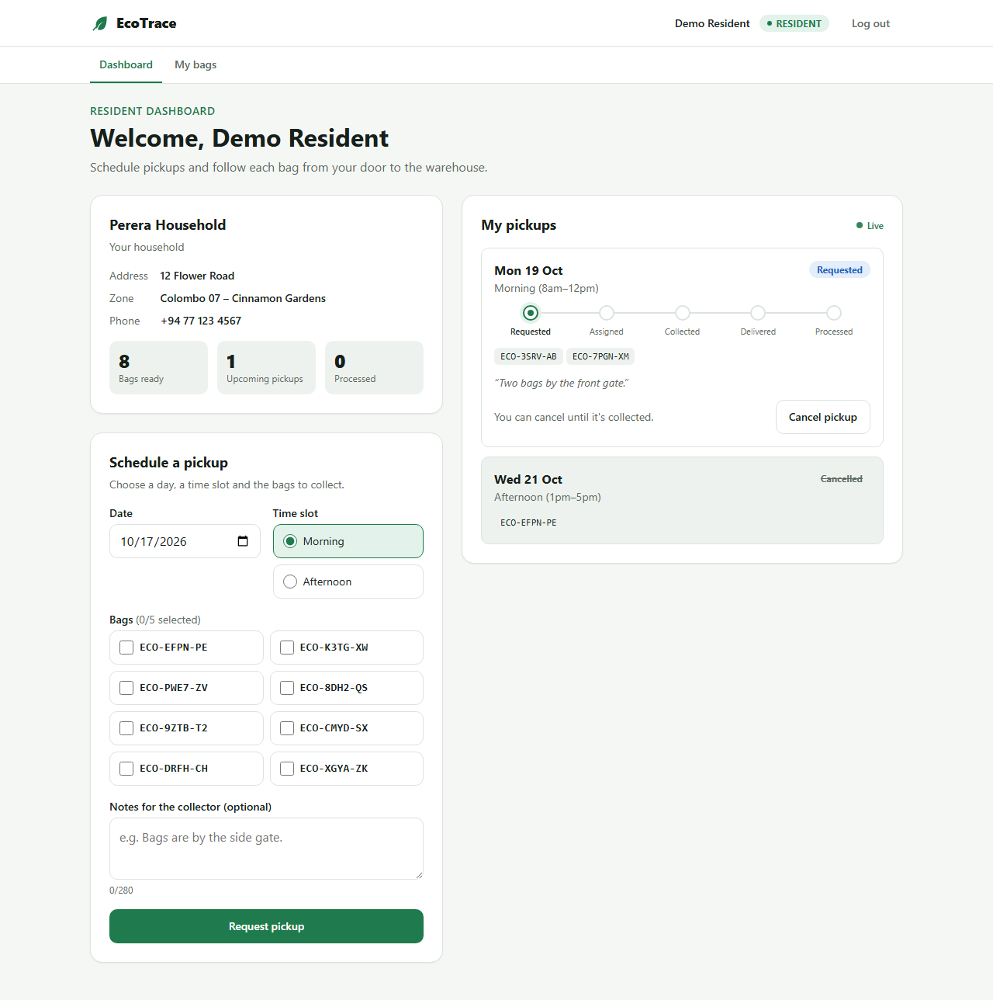
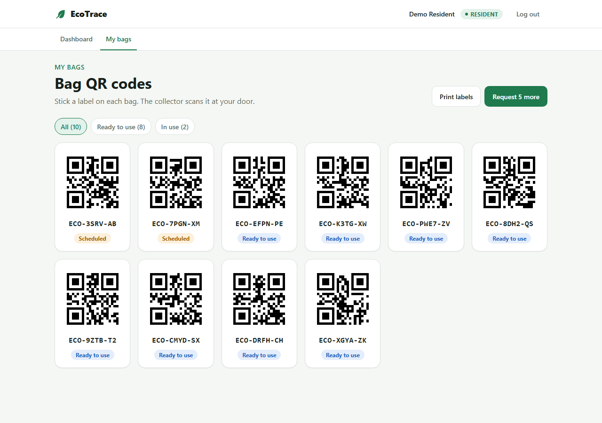
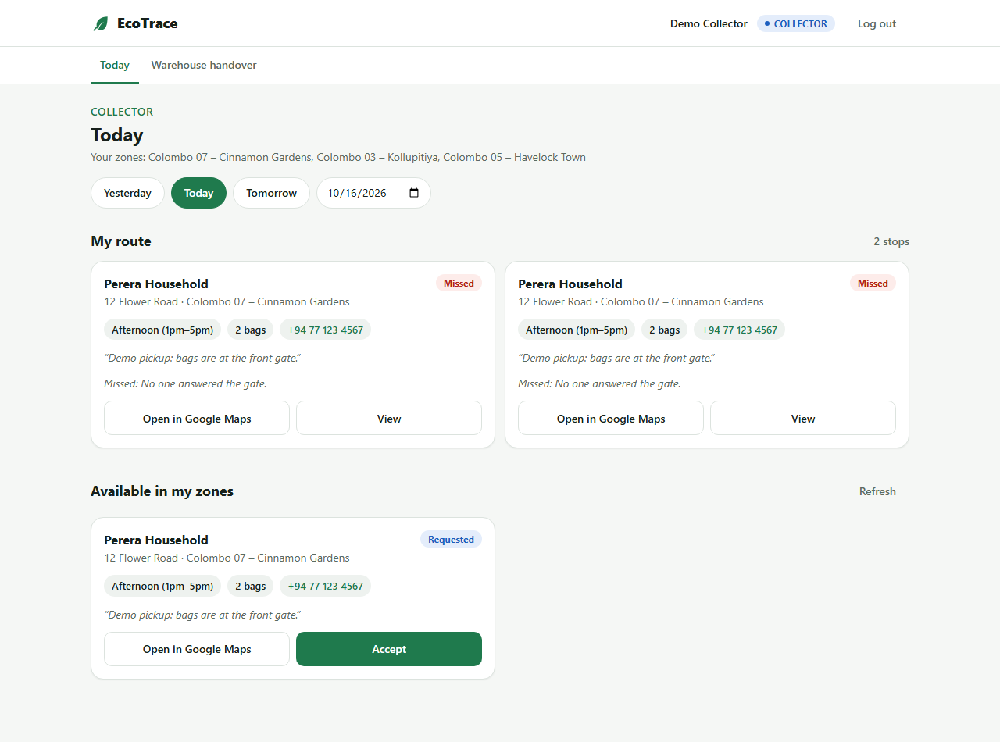
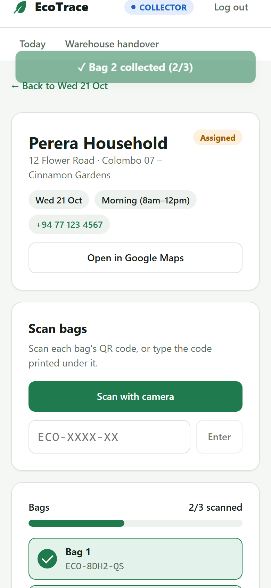
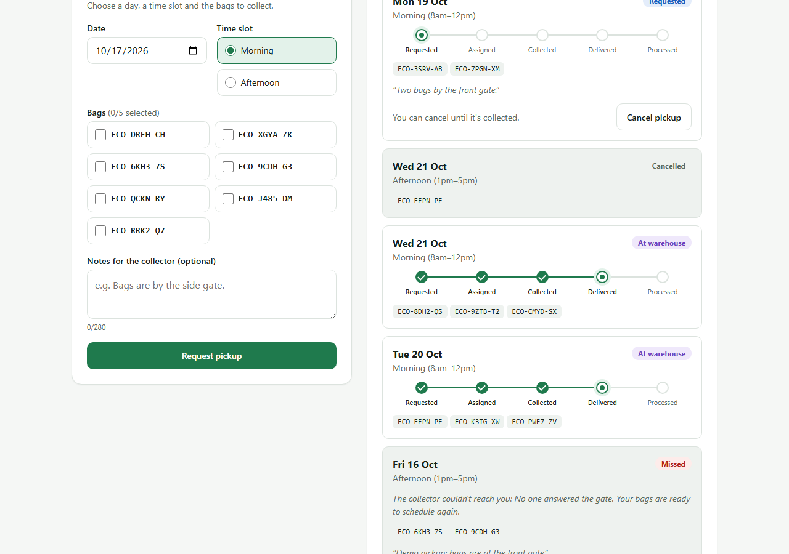
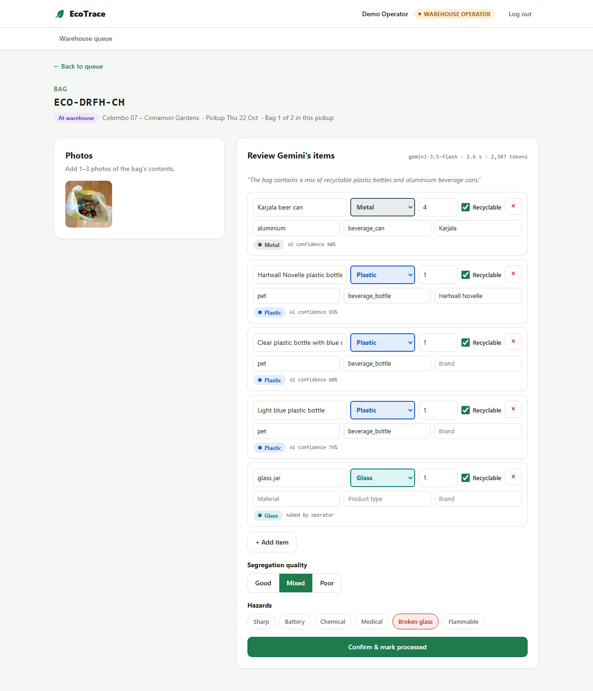
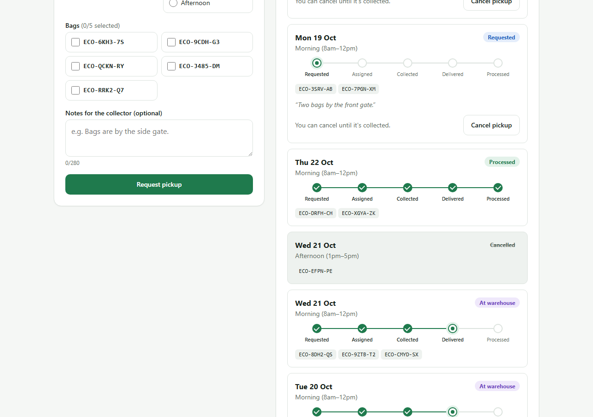
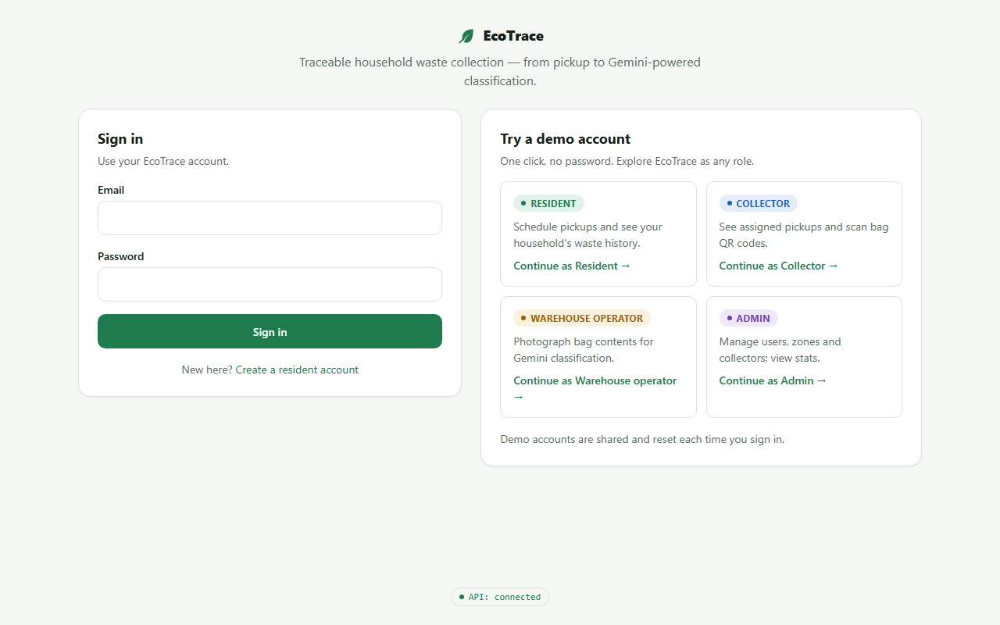

# EcoTrace

Traceable household waste collection, built for the Google Cloud **AI Builder Cup**.

Residents schedule pickups, collectors scan each bag's QR code, warehouse operators photograph bag contents, and **Gemini** classifies the items. Results are stored per household in **Firestore**, and opt-in, anonymized recommendations are served by an API on **Cloud Run**.

> Status: auth, the **resident flow** (onboarding, bag QR codes, scheduling with a live tracker) and the **collector flow** (accept, scan bags with the phone camera, complete, hand over at the warehouse) and the **warehouse operator flow with Gemini** (photograph a bag → AI item list → human review → processed) are live. Recommendations and the partner API are next.

**Try it:** open the web app and click **Try a demo account** — one click signs you in as a resident, collector, warehouse operator or admin (no password). The demo resident already has a household, bags and an upcoming pickup.

## Resident flow

1. **Onboarding** — a new resident enters household name, phone, address and zone; 5 bags with unique QR codes are issued.
2. **My bags** — each bag shows its QR code (generated in the browser) and status; print an A4 label sheet; request 5 more (max 20 unused).
3. **Schedule a pickup** — date (tomorrow…14 days ahead), morning/afternoon, 1–5 ready bags, notes.
4. **My pickups** — live progress tracker *requested → assigned → collected → delivered → processed*, updated in real time with Firestore listeners; cancel while requested/assigned (bags return to ready).

| Dashboard | Bag QR codes |
|---|---|
|  |  |

Data model and rules: [docs/DATA_MODEL.md](docs/DATA_MODEL.md).

## Collector flow

1. **Today** — pickups available in my zones plus my route, with a date switcher, the resident's phone and an *Open in Google Maps* directions link. Bag codes are never shown before the scan.
2. **Pickup screen** — scan each bag's QR with the phone camera (or type the code); a checklist ticks off live with a green/red flash. Wrong bags, typos (caught by the code's check character) and repeat scans get clear messages. Demo accounts get a **Simulate scan** button per bag.
3. **Complete**, **Complete with missing bags** (with a reason; unscanned bags go back to the resident) or **Mark missed** (resident not available).
4. **Warehouse handover** — scan every bag from the van; when a pickup's last bag arrives it becomes *delivered*, and the resident's tracker moves **assigned → collected → delivered** live.

| Today (collector) | Scanning on a phone | Resident tracker |
|---|---|---|
|  |  |  |

## Live

- **Web app (Firebase Hosting):** https://ecotrace-9e406.web.app
- **API (Cloud Run):** https://ecotrace-api-frl7lolcea-el.a.run.app — health check: [`/health`](https://ecotrace-api-frl7lolcea-el.a.run.app/health)

## Tech stack

- **Frontend:** Next.js (TypeScript) on Firebase Hosting
- **Backend:** Python FastAPI on Cloud Run
- **Google Cloud:** Firebase Auth, Firestore, Cloud Storage, Vertex AI Gemini (`asia-south1`)

## Warehouse operator + Gemini

1. **Queue** — bags handed over at the warehouse, oldest first (scan or type a code to open one).
2. **Photograph** the bag's contents (phone camera or upload; demo accounts can use a sample photo). Photos are
   resized in the browser and stored in a private Cloud Storage bucket that deletes them after 30 days.
3. **Gemini on Vertex AI** (`gemini-3.5-flash`, asia-south1, structured output) lists every item with a category
   from a fixed taxonomy, material, quantity, recyclability and confidence, plus segregation quality and hazard
   flags — typically in 2–3.5 s. The prompt forbids transcribing personal information and treats any text in the
   photo as a label, never an instruction.
4. **Review** — the operator edits the table (low-confidence rows highlighted), then confirms. Both Gemini's
   answer and the final list are stored, so AI accuracy can be measured. If Gemini is unavailable, the operator
   enters items manually.
5. When a pickup's last bag is confirmed, the resident's tracker reaches **Processed** live.

| Gemini result | After review | Resident tracker |
|---|---|---|
|  |  |  |

Sample photos: Wikimedia Commons, see [docs/sample-images/CREDITS.md](docs/sample-images/CREDITS.md).

## Roles & auth

- Firebase Authentication; the user's **role is a Firebase custom claim** (`resident`, `collector`, `operator`, `admin`), mirrored in Firestore `users/{uid}`.
- Anyone who signs up is a resident. Staff accounts are created by an admin or the seed script.
- The FastAPI backend verifies every Firebase ID token with the Admin SDK and checks roles per endpoint.

| Endpoint | Auth | Purpose |
|---|---|---|
| `GET /health` | none | Liveness |
| `POST /auth/register` | ID token | First-time sign-up → resident (never changes an existing role) |
| `GET /me` | ID token | Profile + role |
| `POST /auth/demo/{role}` | none (rate-limited) | Repair demo user, return a Firebase custom token |
| `GET /zones` | none | Service zones |
| `POST /households` · `GET`/`PATCH /households/me` | resident | Onboarding + 5 starter bags; view/update household and consent |
| `GET /bags/mine` · `POST /bags/request-more` | resident | List bags; issue 5 more (max 20 unused) |
| `POST /pickups` · `GET /pickups/mine` · `POST /pickups/{id}/cancel` | resident | Schedule (validated), list, cancel |
| `GET /collector/pickups?date=` · `GET /collector/pickups/{id}` | collector | Available in my zones + my route (no bag codes) |
| `POST /collector/pickups/{id}/accept` · `/scan` · `/complete` · `/missed` | collector | Accept, scan a bag, complete (full/partial), missed |
| `POST /collector/pickups/{id}/simulate-scan` | demo collector | Scan without a printed label |
| `GET /collector/handover` · `POST /collector/handover/scan` | collector | Bags in my van; hand over at the warehouse |
| `GET /taxonomy` | none | Waste categories, hazard flags, segregation levels |
| `GET /operator/queue` · `GET /operator/bags/{code}` | operator | Warehouse queue; bag + draft analysis |
| `POST /operator/bags/{code}/analyze` | operator | 1–3 photos → Gemini structured result (draft) |
| `POST /operator/bags/{code}/confirm` | operator | Final items → bag processed (last bag → pickup processed) |



## Repository layout

```
frontend/   Next.js app
backend/    FastAPI service + Dockerfile
docs/       Submission tracker, data model, screenshots
scripts/    Deploy scripts + demo seed script
firebase.json, .firebaserc, firestore.rules, firestore.indexes.json   Firebase Hosting + Firestore config
```

## Run locally

**Frontend**

```bash
cd frontend
npm install
npm run dev     # http://localhost:3000
```

**Backend**

```bash
cd backend
python -m venv .venv
# Windows: .venv\Scripts\activate   |   macOS/Linux: source .venv/bin/activate
pip install -r requirements-dev.txt
uvicorn app.main:app --reload --port 8080   # http://localhost:8080/health
pytest
```

**Backend via Docker**

```bash
cd backend
docker build -t ecotrace-backend .
docker run -p 8080:8080 ecotrace-backend
```

For local frontend dev against a local backend, copy `frontend/.env.example` to `frontend/.env.local` (fill in the Firebase web config from the Firebase console), and run the backend with `ALLOWED_ORIGINS=http://localhost:3000` and `GOOGLE_CLOUD_PROJECT=ecotrace-9e406` using your ADC (`gcloud auth application-default login`).

## Deploy

Prerequisites: `gcloud` and `firebase` CLIs, logged in (`gcloud auth login`, `firebase login`) with access to project `ecotrace-9e406`. Run from Git Bash (or any bash):

```bash
./scripts/deploy-backend.sh    # Cloud Build -> Cloud Run service "ecotrace-api"
./scripts/deploy-frontend.sh   # static export -> Firebase Hosting (API URL read from Cloud Run)
firebase deploy --only firestore   # security rules + composite indexes
backend/.venv/Scripts/python scripts/seed_demo_users.py   # create/repair demo users + demo resident data (idempotent)
```

## Secrets

No secrets are committed. Local config goes in `.env` (git-ignored; see `.env.example`); deployed services use Secret Manager.
