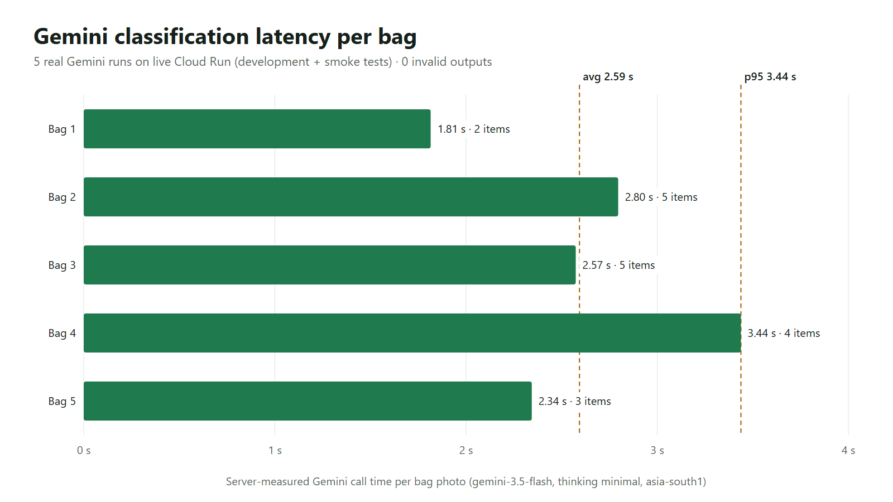
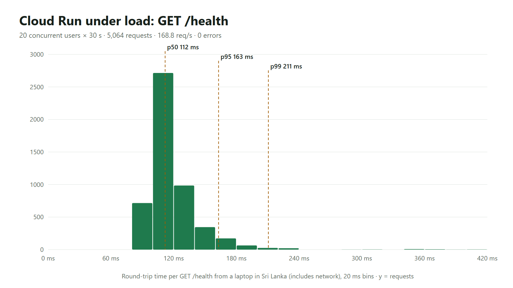

# EcoTrace — performance & AI report (submission, 2026-10-17)

**Scope.** We kept the demo on the free tier, so this report makes **no extra Gemini calls**. The Gemini numbers
come from the classifications that already ran on the live system: development runs plus the final end-to-end smoke
test, read back from Firestore by `benchmark/live_metrics.py`. Cloud Run capacity is measured with a light load test
on `/health`. A labelled-dataset accuracy benchmark (e.g. TrashNet) is planned but **not run** (see Limitations).

## Key numbers

| Metric | Value | Source |
|---|---|---|
| Gemini classification latency, avg / p95 | **2.59 s / 3.44 s** (min 1.81 s) | 5 live calls, server-measured |
| End-to-end analyse request (upload → Gemini → draft saved), seen by the client | 2.9 – 5.3 s | 4 calls in the final smoke test |
| Invalid / unparseable model output | **0 of 5** | structured output + `parse_ai_output` |
| Failures → manual fallback | 1, and the fallback worked | deliberately forced (1 ms timeout on a no-traffic test revision) |
| Items per bag photo | 3.8 avg (2 – 5) | |
| Items under 60 % confidence | 0 % | |
| Estimated Gemini cost per bag photo | **≈ US$0.006** (bound US$0.004 – 0.021) | see Cost |
| `GET /health`: 20 concurrent users × 30 s | **5,064 requests, 168.8 req/s, 0 errors** | `benchmark/load_health.py` |
| `/health` round trip p50 / p95 / p99 | **112 / 163 / 211 ms** (max 402 ms) | from a laptop in Sri Lanka, network included |
| Full chain: resident schedules → collector scans → warehouse handover → Gemini → operator confirm → resident insights → admin → partner API | **every step passes** | live smoke test, 2026-10-17 (plus all 4 one-click demo logins) |





## Gemini classification (live runs)

- **Model / settings:** `gemini-3.5-flash` on Vertex AI `asia-south1`, `thinking_level=minimal`, structured output
  (`response_schema` with category / segregation / hazard enums), 25 s timeout, one retry.
- **Latency:** 5 calls with a result: 1.81, 2.34, 2.57, 2.80 and 3.44 s. Average 2.59 s, nearest-rank p95 3.44 s.
  During development, `minimal` thinking took about 2–3.5 s per bag, versus about 7.6 s at `low` and about 11 s at the
  default level, with comparable item lists.
- **Robustness:** every response parsed (0 invalid outputs). The one failure was our forced-timeout test: the
  operator page switched to manual entry and the bag was still confirmed.
- **Consistency (qualitative):** the same public sample photo (`bag-recyclables.jpg`: plastic bottles and cans in a
  bag) gave **2 items in one run and 5 in another**. The categories were right both times (plastic, metal), but the
  item granularity varied. This is why EcoTrace keeps a **human review step** and stores both `aiResult` and
  `finalItems`.
- **Accuracy is not reported from these runs.** The operator edits on them were scripted UI tests (we deleted and
  changed items on purpose), so a "correction rate" would be meaningless. All of these records are flagged `isTest`
  and excluded from the in-app AI-quality panel, which will measure real operator corrections from now on.

### Qualitative examples

The operator's *Use a sample photo* button uses 4 **real, openly licensed Wikimedia Commons photos**, not synthetic
images: recyclables in a bag, packaging, e-waste and an unsorted heap (credits:
[`docs/sample-images/CREDITS.md`](../docs/sample-images/CREDITS.md)). Gemini's output and the operator review for one
of them are shown in [`step4-results.png`](../docs/screenshots/step4-results.png) and
[`step4-edited.png`](../docs/screenshots/step4-edited.png). The 50 "synthetic households" in the demo are
**synthetic records**, not images. They never go through Gemini and are excluded from every AI metric.

## Cost

- **Pricing used:** Gemini 3.5 Flash on Vertex AI, **US$1.50 per 1M input tokens and US$9.00 per 1M output
  tokens** (including thinking). These rates come from third-party listings retrieved 2026-10-17
  ([llmreference.com](https://www.llmreference.com/model/gemini-3.5-flash/gcp-vertex-ai),
  [getmaxim.ai](https://www.getmaxim.ai/bifrost/llm-cost-calculator/provider/vertex_ai/model/gemini-3.5-flash)),
  because Google's pricing page did not render for us. Check
  [cloud.google.com/vertex-ai/generative-ai/pricing](https://cloud.google.com/vertex-ai/generative-ai/pricing)
  before relying on them.
- **Tokens:** the operator UI showed **2,347 tokens** for a typical bag (photo + prompt + structured answer). We don't
  store the input/output split. Assuming about 2,000 input and about 350 output tokens, a bag costs **≈ US$0.006**.
  - Bound if every token were input: US$0.004.
  - Bound if every token were output: US$0.021.
  - Per 1,000 bags: about **US$6**.
- **Rest of the stack:** Cloud Run scales to zero (`min-instances 0`); Firestore, Hosting and Storage stay within free
  quotas at demo scale.

## Load test (`/health`)

- **Setup:** 20 asyncio users loop `GET /health` for 30 s over HTTP/1.1 keep-alive. One warm-up request is sent
  first, so the cold start is excluded. Max 3 Cloud Run instances; 1 vCPU / 512 MiB each.
- **Result:** 5,064 requests, 168.8 req/s, **0 errors**. p50 112 ms, p95 163 ms, p99 211 ms, max 402 ms. Most of the
  ~110 ms is the network round trip from Sri Lanka to Mumbai (`asia-south1`), not server time.
- **What it shows:** routing, TLS and the container keep up with 20 concurrent clients without errors. It does
  **not** exercise Firestore, Gemini or auth.

## Limitations (honest)

1. **No labelled accuracy benchmark yet.** We chose not to spend on extra Gemini calls. The planned next step is a
   seeded sample of TrashNet (5 images × 6 classes, mapped to our taxonomy), with production vs default thinking.
   TrashNet photos show **single items on plain backgrounds**, which is easier than a real mixed bag, so even that
   would overstate real-world accuracy.
2. **Tiny sample.** Only 5 live Gemini calls, so the latency figures are indicative, not statistically robust.
3. **Category level only.** Item names, quantities and brands are not scored.
4. **Load test covers `/health` only,** measured from one client location, network included.
5. **Pricing** comes from third-party listings (see Cost).

## Reproduce

```bash
backend/.venv/Scripts/python benchmark/live_metrics.py       # read-only: Gemini metrics from live records
backend/.venv/Scripts/python benchmark/load_health.py 20 30  # load test; save stdout to benchmark/results/load_health.json
node benchmark/charts.js                                     # charts -> benchmark/results/*.png (needs Playwright)
```

Raw data: [`results/live_gemini.json`](results/live_gemini.json) and
[`results/load_health.json`](results/load_health.json).
